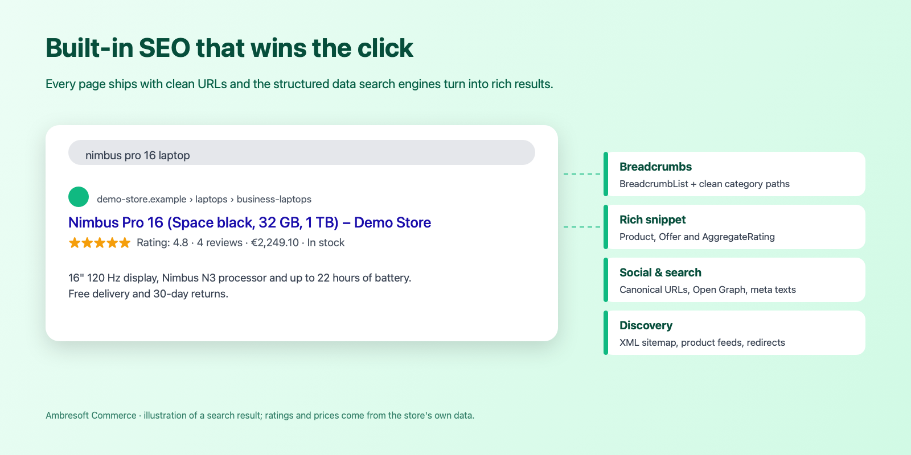

<p align="center">
  <picture>
    <source media="(prefers-color-scheme: dark)" srcset="public/brand/ambresoft-lockup-white.svg">
    
  </picture>
</p>

<h1 align="center">Ambresoft Commerce</h1>

<p align="center"><strong>The open-source B2C ecommerce platform that gives you an enterprise store — without the enterprise bill.</strong></p>

<p align="center">
  B2C · Self-hosted · Open source (AGPL-3.0) · Multilingual · AI-assisted · FrankenPHP, Typesense and Redis for speed
</p>

---

Ambresoft Commerce is built for **B2C online stores** — brands and retailers selling directly to consumers.

Most store platforms make you choose: rent a hosted SaaS and pay a cut of every sale forever, or stitch together a
dozen plugins and hope they keep working. **Ambresoft Commerce gives you a complete, modern store that you own.**
Catalog, storefront designer, checkout, payments, shipping, taxes, marketing, reports and AI writing tools ship in
one coherent product — designed together, tested together, and running on your own server.

**Clone it, run one command, and you are looking at a fully stocked demo shop** with real product photos, deals,
banners, a blog and a populated admin. Then make it yours.

Ambresoft Commerce is free software under the [GNU Affero General Public License v3.0](LICENSE). See the
[third-party notices](THIRD_PARTY.md) for bundled components.

## Why merchants choose it

- **No platform fees, no lock-in.** Your data lives in your own PostgreSQL database. Export everything to CSV at any time.
- **Everything in the box.** Features other platforms sell as paid apps — promotions, gift cards, reviews, abandoned-cart
  reminders, XML feeds, sitemaps, newsletters, reports — are included.
- **A storefront you design without code.** Drag blocks onto a 16-column grid, preview on desktop, tablet and phone, publish.
- **AI that does the writing.** Generate banners, blog posts, newsletters and FAQs in every store language with your own
  Anthropic API key — you review and save, nothing goes live on its own.
- **Built for real operations.** Staff roles and permissions, a full audit trail, order workflows, invoices and packing
  slips, stock rules and server-side price calculation you can trust.
- **Speaks your customers' language.** Admin and storefront in English, Greek, Spanish, French, Italian and Dutch, with
  every piece of merchant content translatable per language.

## Built for speed

Shoppers leave slow stores. Ambresoft Commerce is engineered to be fast from the first request to the search box:

- **FrankenPHP application server.** The app runs on [FrankenPHP](https://frankenphp.dev) — a modern PHP server built on
  Caddy, with PHP embedded directly in the web server and a pool of PHP threads ready to answer. No separate PHP-FPM
  hop, less overhead per request, and a production-grade web server out of the box.
- **Typesense search.** Product search runs on [Typesense](https://typesense.org), a dedicated search engine built for
  instant, typo-tolerant results. Shoppers get suggestions as they type, relevant matches even with spelling mistakes,
  and search that stays fast as your catalog grows — without loading your database.
- **Redis everywhere it counts.** Sessions, the application cache and background queues live in
  [Redis](https://redis.io). The storefront cache is tag-invalidated, so pages are served from memory but a price,
  stock or content change is visible immediately — never stale.
- **PostgreSQL done right.** Business rules and integrity are enforced in the database, with indexed queries for
  listings, filters and reports.
- **Work happens in the background.** Emails, search indexing, feeds and file cleanup run on queue workers and the
  scheduler, so customers never wait for them.

## SEO that brings customers in

<p align="center">
  
</p>

Every storefront page is built to rank and to win the click:

- **Rich results from structured data.** Product pages publish `Product`, `Offer` and `AggregateRating` data, so search
  engines can show price, availability and star ratings right in the results. Category and store pages add
  `BreadcrumbList`, `ItemList`, `Organization` and `WebSite` data.
- **Clean, meaningful URLs.** Products live under their category path (`/laptops/business-laptops/nimbus-pro-16-…`),
  with a canonical URL on every page and per-language slugs.
- **Full control of meta texts.** Page titles, meta descriptions and keywords for products, categories, brands, pages,
  blog posts and layouts, in every language, plus SEO rules to fill them automatically.
- **Social sharing tags.** Open Graph data gives every shared link a proper title, description and image.
- **Discovery and housekeeping.** An XML sitemap with scheduled publication, Google and Meta product feeds, 301
  redirects when URLs change, and noindex controls while you are still building the store.
- **Content that ranks.** A built-in blog, FAQs and static pages — with AI writing help — to target the searches your
  customers make.

## Everything you get

### Catalog & products

- Products with images, files and attachments, SKU / EAN / MPN / ISBN / UPC identifiers and price history.
- Nested categories, products in **multiple categories**, brands with landing pages and banners.
- **Features and filters** (colour, storage, size…), **variation groups** (one product card for every colour or size),
  **product packages** (bundles) and "buy it with" recommendations.
- Stock, availability statuses, pre-orders, quantity rules, per-product shipping and packaging dimensions.
- **Product reviews and ratings**, stickers and badges, recently viewed, wishlists and product comparison.
- Age restrictions per category and customer-group visibility.

### Storefront designer

- Visual **layouts → 16-column grid → blocks** for the homepage, category, product, cart, checkout and every other page.
- Blocks for banner carousels, product carousels (newest, best sellers, on sale, recently viewed or hand-picked),
  categories, brands, blog posts, reels, coupons and offers, menus and mega menus, link directories, newsletters,
  popular searches, custom HTML and more.
- **Banner designer** with separate desktop / tablet / phone layouts, masks, buttons and product overlays.
- Website menus, static pages with forms, blog with categories, FAQs, a theme **code editor** for your own CSS/JS,
  and SEO: canonical URLs, structured data, redirects, rules, robots controls and an XML sitemap.
- Fast by design: a tag-invalidated storefront cache keeps pages quick without serving stale prices or stock.

### Checkout, payments & shipping

- Guest and account checkout, saved addresses, server-calculated totals, invoice requests with **EU VIES / Greek AADE
  VAT verification**.
- Payments: cash on delivery, bank deposit and **Stripe Checkout** built in, more providers as add-ons;
  payment fees and limits, payment restrictions per category or customer.
- Shipping carriers and methods, rate areas, free-shipping rules, regions and countries.
- Taxes with priorities, rate areas and price-included options; currency and number-format settings.

### Orders & customers

- Order management with custom statuses, bulk status changes, shipments, invoices, packing slips and customer emails
  you can edit and test.
- Customer accounts, groups, blacklist, call-back requests, **Google sign-in** and account-security history.
- Abandoned **carts** with automatic **cart reminders**.

### Marketing & growth

- **Promotions** (automatic discounts and free shipping), **coupons**, **gift cards** and scheduled **product sales**.
- **Newsletters**: lists, subscribers and campaigns with live preview.
- **Google Analytics**, **Google Tag Manager**, **GDPR cookie consent**, Google / Meta **product feeds**.
- A ready **Black Friday theme** add-on.

### AI assistants (bring your own key)

- **Banner generation**, **blog writing**, **newsletter writing** and **FAQ writing** in every active language, as a chat
  inside the editor. Ask for changes, undo, then save.
- Usage limits per staff member and an AI activity log. Keys are encrypted and never sent to the browser.
  See [AI configuration and history](docs/architecture/ai-settings.md).
- The **Ambresoft shopping assistant** for your storefront is a separate product; its add-on only needs the assistant's
  widget ID.

### Imports & exports

- **CSV import** for products, categories, brands and regions — upload, validate, preview every change, then confirm.
- **CSV export** of the same records with column picking, filters and selected rows, in the import format so files
  round-trip.

### Administration you can trust

- Staff **roles and permissions** enforced on the server, **passkeys** and session security.
- A complete **audit log** of every change, with who, when and what changed.
- Reports: sales, orders, products, categories, customers, inventory and promotions.
- Live admin notifications, a dashboard, and an admin translated into six languages.

### Extensible

- **Add-on system** with bundled add-ons (Stripe Checkout, Typesense search, Sitemap, Product feeds, Google Analytics,
  Google Tag Manager, GDPR cookies, Cart reminders, Black Friday theme) and ZIP upload for your own.
- Published extension contracts for payment methods, storefront blocks, widgets and settings panels — see the
  [add-on developer guide](docs/addons.md).

## Built for ownership and extension

Ambresoft Commerce uses **Laravel 13, PHP 8.3+ (the Docker image runs PHP 8.5 on FrankenPHP), PostgreSQL, Redis, Inertia 3, React 19, TypeScript and Tailwind CSS 4**.

The application is a modular monolith organized by business context. Server-side workflows own pricing, stock, validation and permissions. Add-ons use published extension contracts, while storefront themes and blocks build on the existing presentation system.

- [Architecture overview](docs/architecture/overview.md)
- [Project structure](docs/project-structure.md)
- [Add-on developer guide](docs/addons.md)
- [Storefront layouts and blocks](docs/architecture/storefront-architecture.md)

## Get started locally

Use these instructions for a **new checkout**. Existing installations must retain their environment file, application key, Compose project name and persistent volumes; follow the [development and update guide](docs/development.md) instead of initializing them again.

### Requirements

- Docker with Docker Compose.
- Node.js **22.13+ within Node 22** and **pnpm 10.24.0** for frontend commands.

FrankenPHP serves the application in classic mode. PHP, Composer, PostgreSQL and Redis run in Docker. A Docker-only frontend workflow is also documented in the [setup guide](docs/development.md#docker-only-frontend-alternative).

### Installation

1. Clone this repository.
2. If `.env` does not exist, copy `.env.example` to `.env`. Review the local settings and set `APP_URL` to your actual local address.
3. From the project root, run:

   ```sh
   make install
   docker compose run --rm --no-deps app php artisan key:generate
   docker compose run --rm app php artisan migrate
   docker compose run --rm app php artisan cms:permissions-sync
   docker compose run --rm app php artisan cms:addons-sync
   pnpm build
   docker compose up -d app worker scheduler typesense
   ```

   Generate the application key only when initializing a new installation. Never replace an existing installation's key as an update step.

4. **See everything in action — load the demo store and a superadmin:**

   ```sh
   docker compose exec -T app php artisan cms:demo-store --with-admin
   ```

   This fills a complete electronics shop — 37 products with real photos across phones, tablets, laptops, audio,
   wearables and accessories, including a fully specified Nimbus Pro 16 flagship with variants, features, reviews and a
   Black Friday deal — plus brands, deals, coupons, banners, videos, blog posts, FAQs, pages, customers, orders,
   instant search and a fully built homepage — and creates the super administrator `admin@example.com`. The password is generated and **printed once**
   in the terminal. Open [localhost:8000/admin](http://localhost:8000/admin) and sign in.

   The demo administrator is **local only**: the command refuses `--with-admin` outside the `local` environment, and the
   repository ships no fixed password.

5. **Starting a real store instead?** Skip the demo and send yourself a private setup link:

   ```sh
   docker compose exec -T app php artisan cms:admin-setup owner@example.com --name="Store owner"
   ```

   Open [Mailpit](http://localhost:8025), follow the link and choose your password.

| Local service           | Address                                             |
| ----------------------- | --------------------------------------------------- |
| Storefront              | [localhost:8000](http://localhost:8000)             |
| Administration          | [localhost:8000/admin](http://localhost:8000/admin) |
| Development email inbox | [localhost:8025](http://localhost:8025)             |

The supplied Compose configuration is for local development. Use the [security guidance](docs/architecture/security.md) and an appropriate production deployment process before publishing a customer store.

## Configure your store

Start with company details, languages, currencies, taxes, shipping and payment methods. Then create the catalog, configure layouts and menus, and enable the add-ons your store needs.

During development, General settings → Basic settings → Storefront access lets you close the store to visitors while verified staff retain preview access. The separate development indexing setting adds `noindex, nofollow` to the storefront; disable it when the public store is ready for indexing.

Keep queue workers and the scheduler running for background work such as email, search indexing and file cleanup. See [runtime operations](docs/development.md#runtime-operations) for the supported workflows.

## Documentation

| Topic                            | Guide                                                                   |
| -------------------------------- | ----------------------------------------------------------------------- |
| Installation, updates and checks | [Development and operations](docs/development.md)                       |
| Staff access and capabilities    | [Authorization](docs/architecture/authorization.md)                     |
| Languages and translated content | [Localization](docs/architecture/localization.md)                       |
| Product management               | [Products](docs/architecture/products.md)                               |
| Product variation groups         | [Variations](docs/architecture/variations.md)                           |
| Payments and provider setup      | [Payments](docs/architecture/payments.md)                               |
| Shipping and carrier setup       | [Shipping](docs/architecture/shipping.md)                               |
| Storefront customization         | [Storefront architecture](docs/architecture/storefront-architecture.md) |
| Extension development            | [Add-ons](docs/addons.md)                                               |
| XML sitemaps                     | [Sitemap add-on](docs/architecture/xml-sitemap.md)                      |
| AI provider settings and history | [AI settings](docs/architecture/ai-settings.md)                         |
| Local AI development tooling     | [Claude Code and Boost guidance](CLAUDE.md)                             |
| Security practices               | [Security](docs/architecture/security.md)                               |

Architecture decisions and phase reports record the project's implementation history. They do not define customer license entitlements or promise future features.

## Development checks

```sh
make check
```

The project uses PHPUnit with an isolated PostgreSQL test database, Vitest and Testing Library, PHPStan/Larastan, Pint, TypeScript, ESLint, Prettier and Vite. See the [verification guide](docs/development.md#verification) for individual commands and environment requirements.

### MCP for local development

The repository includes **Laravel Boost** as a Composer development dependency, with an MCP configuration for **Claude Code** in [`.mcp.json`](.mcp.json). It helps AI coding tools inspect the Laravel application and work with the installed framework. Project instructions live in [AGENTS.md](AGENTS.md) and [CLAUDE.md](CLAUDE.md), with reusable skills under `.agents/skills/`.

Codex and Claude Code share one skill library: [`.agents/skills/`](.agents/skills/) contains the actual skills and supporting files; `.claude/skills/` contains relative links to the same directories. Edit the canonical files once for both tools. Claude settings stay in `.claude/`, and Boost writes skill updates to the shared library through `config/boost.php`. See [skill maintenance](docs/development.md#shared-ai-skills).

The checked-in configuration targets the project's local `cms-foundation` Docker environment through the guarded [`scripts/boost-mcp.php`](scripts/boost-mcp.php) launcher. Boost uses a local stdio connection, stays disabled in the ordinary web application, and must never be exposed as a public endpoint or connected to production credentials or databases. See [the local tooling guidance](CLAUDE.md#local-development-tooling) before using it in your development setup.

Laravel Boost is development tooling only.

## Contributing and security

Contributions are welcome; see [CONTRIBUTING.md](CONTRIBUTING.md) and the [Code of Conduct](CODE_OF_CONDUCT.md). Please report vulnerabilities privately as described in [SECURITY.md](SECURITY.md), not in public issues.

## License

Copyright © 2026 Ambresoft.

Ambresoft Commerce is licensed under the [GNU Affero General Public License v3.0 only](LICENSE). Third-party components keep their own licenses; see [THIRD_PARTY.md](THIRD_PARTY.md) and the distributed dependency packages.
